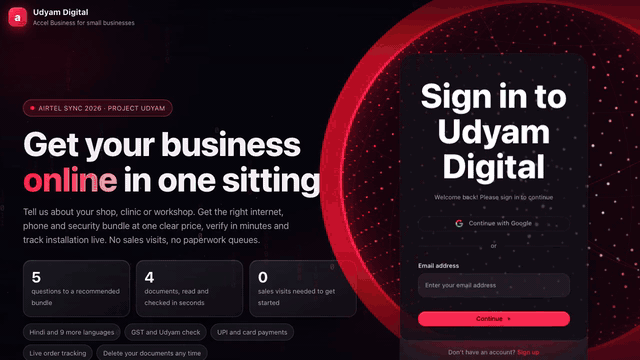
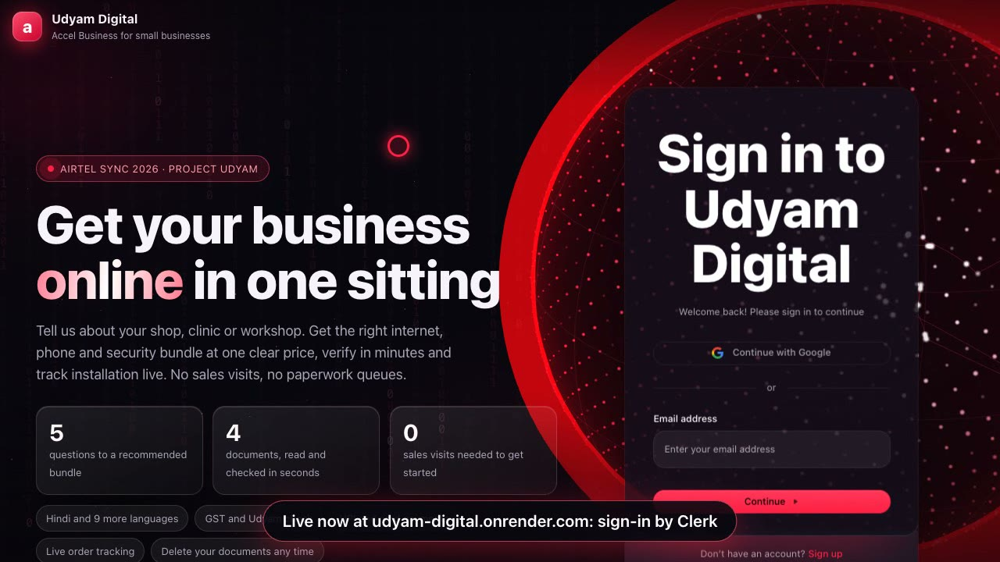
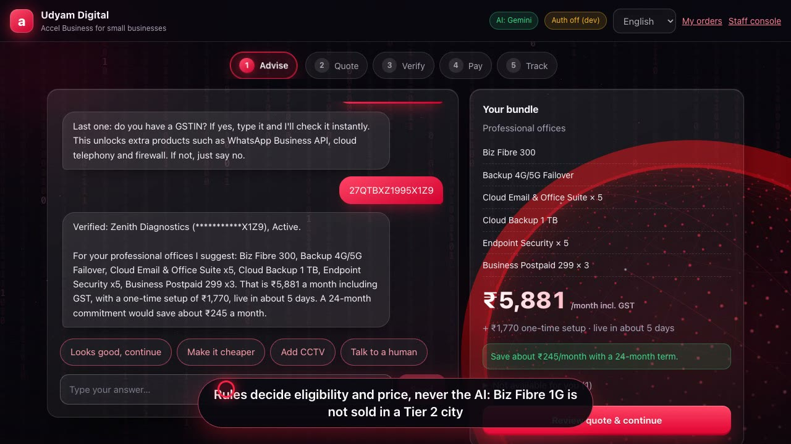
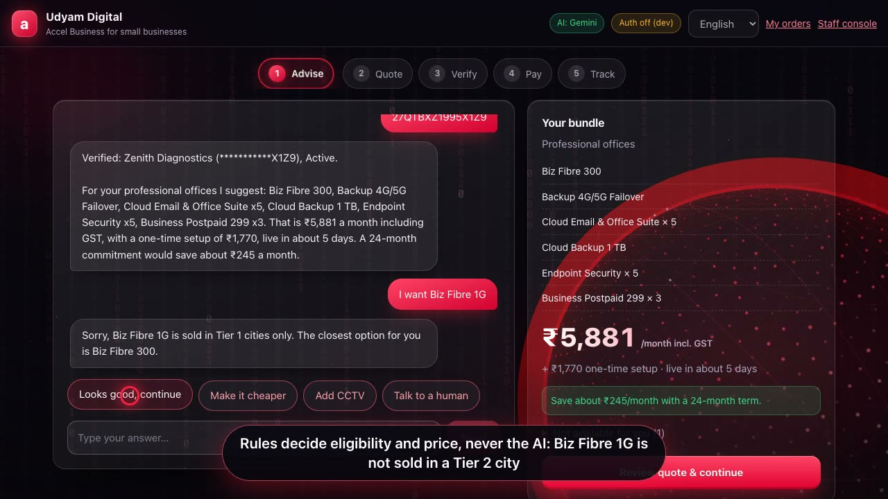
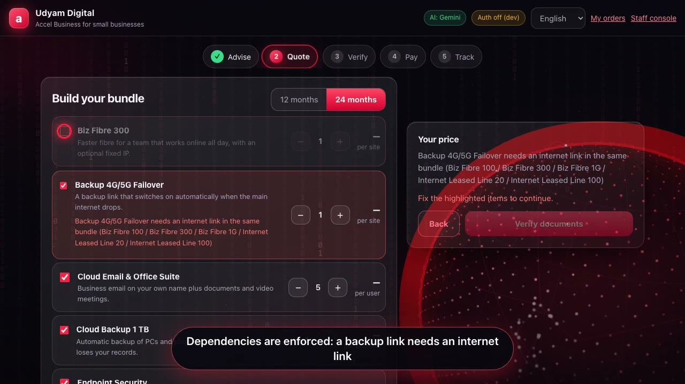
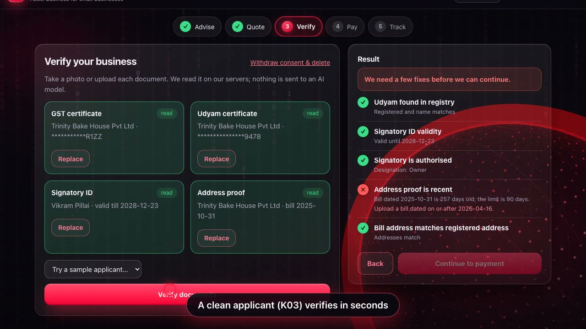
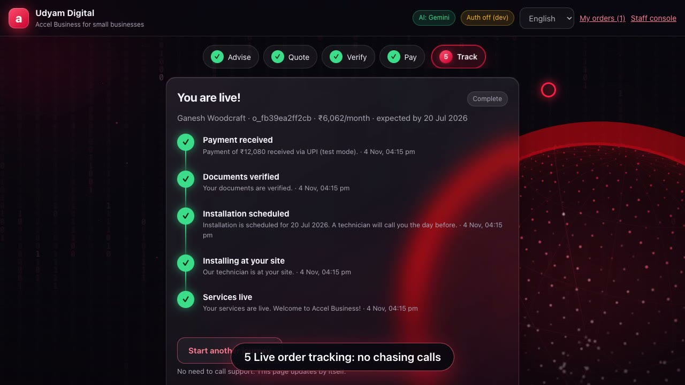
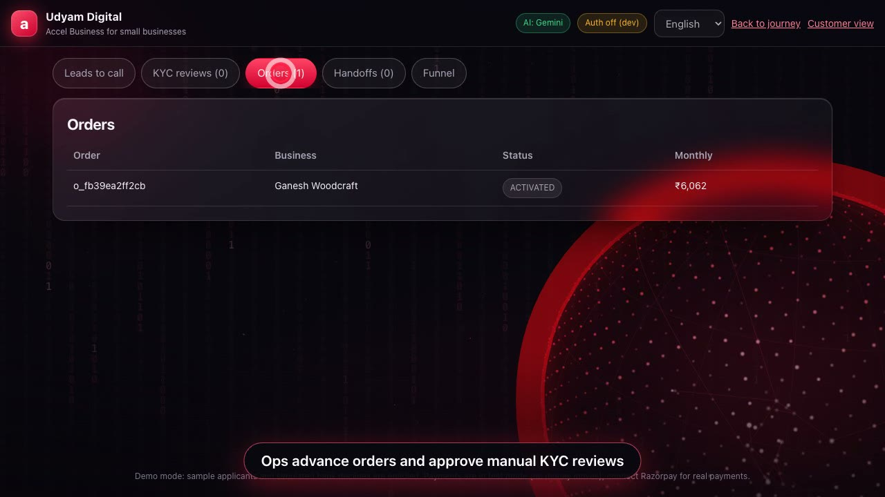
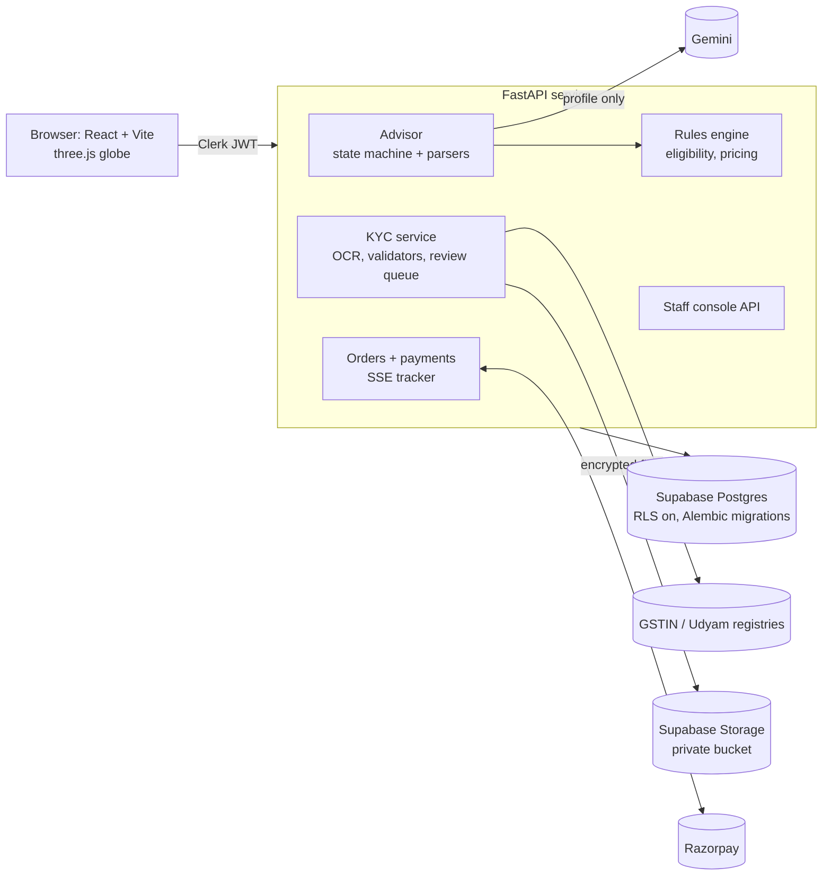

<div align="center">

# Project Udyam Digital

**Get a small business online in one sitting: advice, a clear price, instant KYC, payment and live tracking, on a phone, in the owner's language.**

Built by **Team Cracker** for **Airtel Sync 2026 · Digital Track** (Enterprise Track A, Accel Business)

[**Live app**](https://udyam-digital.onrender.com) · [**Demo video (2 min 48 s)**](udyam/docs/demo/udyam-demo.mp4) · [Architecture](udyam/docs/ARCHITECTURE.md) · [Privacy note](udyam/docs/PRIVACY_NOTE.md) · [Pitch deck](udyam/docs/TeamCracker_Airtel_Sync_Digital_draft.pdf)

[](udyam/docs/demo/udyam-demo.mp4)

<sub>Click the preview (8x speed) to play the full 2 min 48 s walkthrough. The live app runs against Razorpay **test mode**, so no money moves.</sub>

</div>

---

## The problem

Accel Business sells to India's 6 crore+ micro, small and medium businesses through a field force built for large accounts. For a kirana store or a clinic that means a visit, a PDF quote nobody understands, paper KYC and two weeks of waiting. The case data shows the cost:

| Funnel stage (Apr–Jun 2026, 5,000 leads) | Leads | Of previous |
|---|---:|---:|
| Contacted | 3,406 | 68% |
| Needs assessed | 1,974 | 58% |
| Quote accepted | 861 | 44% |
| KYC complete | 588 | 68% |
| **Activated** | **368** | **63%** |

Only **7.4%** activate, it takes **17.6 days**, customers chase status **3 times**, and each activation costs **₹15,053**. Digging into `smb_leads.csv` shows where the loss is fixable by software: **827** leads were lost to the sales visit ("no time", "not scheduled"), **385** to slow or confusing quotes, **273** to paperwork.

## What we built

A working product, not a mock-up. A business owner can do all of this on a phone:

| Step | What happens |
|---|---|
| **1. Advise** | A chat asks 4–5 plain questions (business type, staff, city, current internet, GSTIN) in ten Indian languages and recommends a bundle with the "why" in everyday words. Typing a GSTIN verifies it against the registry on the spot. |
| **2. Quote** | One transparent monthly price. Toggle add-ons, pick 12 or 24 months, watch the price update. Eligibility (city tier, size, GSTIN, product dependencies) is enforced by rules, and the server re-prices at checkout. |
| **3. Verify (Smart KYC)** | A consent notice first (DPDP Act, 2023), then four documents are read by OCR and cross-checked against the GST and Udyam registries: status, names, address, ID validity, bill age. Failures say exactly what to fix. |
| **4. Pay** | Razorpay Checkout. The server confirms every payment (signature, amount, webhook); the browser can never mark an order paid. |
| **5. Track** | A live order tracker (server-sent events) replaces the chasing calls. **My orders** lists every order. |
| **Staff console** | Sales and ops get leads the digital journey did not close, ranked by a propensity score with a suggested next action, a manual-review queue for documents, and an order board to advance installation. |

| | |
|---|---|
|  |  |
| **Sign-in** (Clerk) over a live 3D globe of Indian cities | **Advisor** recommends a bundle; price animates |
|  |  |
| **Rules, not the AI, decide**: Biz Fibre 1G is refused in a Tier 2 city, with the reason | **Dependencies enforced**: a backup link needs an internet link |
|  |  |
| **Smart KYC** catches a stale utility bill | **Live tracking**, no support calls |
|  | |
| **Sales console**: ranked leads, next best action | |

## Design decisions worth knowing

**The LLM narrates; rules decide.** A 7% funnel cannot afford a hallucinated price. Gemini (free tier) only phrases explanations, rescues answers the parser cannot read, and translates. Eligibility, bundle choice and pricing are plain Python in [`rules.py`](udyam/backend/app/rules.py), covered by tests and re-run on the server at checkout. If Gemini is down or rate-limited, a circuit breaker switches to templated English and Hindi and the journey keeps working.

**KYC that survives bad photos.** [`kyc.py`](udyam/backend/app/kyc.py) straightens tilted photos, rejects blurred ones, removes watermarks, reads fields with Tesseract and repairs OCR mistakes with the GSTIN checksum and the registry. All 12 specimen applicants in the case data behave as planned:

| Applicant | What the system does |
|---|---|
| K03, K05, K06, K10, K12 | Verified |
| K01 | GST registration **cancelled** (GST products withheld, others still sold) and the Udyam number is missing |
| K02 | Photo tilted 7°: straightened automatically, then verified; signatory flagged for review |
| K04 | GST certificate too **blurred**: re-upload requested |
| K07 | Legal name on the certificate does not match the registry |
| K11 | Electricity bill is 257 days old (limit 90) |
| K08, K09 | Signatory is an office admin: manual review, not auto-approved |

**Privacy by design** ([full note](udyam/docs/PRIVACY_NOTE.md)). Consent is recorded before any document is requested and can be withdrawn with one click, which deletes the files. IDs are masked in every response and log. Documents and extracted fields are Fernet-encrypted before they reach a private storage bucket. Gemini only ever sees the business profile, never an ID or an image. Rejected or abandoned documents are deleted after 30 days.

**Payments the browser cannot fake.** The server creates the Razorpay order, verifies the HMAC signature, fetches the payment and compares order id, currency, status and amount, refuses to reuse one payment for two orders, and also listens to Razorpay's signed webhook. The test-mode shortcut is disabled the moment live keys are configured.

**Real access control.** Clerk handles sign-in; the API verifies every token (signature, expiry, issuer). Customers can only read their own sessions, cases and orders. Staff roles (`sales`, `ops`, `admin`) come from the signed token, so a customer cannot promote themselves. Opening a document is audited.

## Architecture



| Layer | Choice |
|---|---|
| Frontend | React 18, Vite, hand-written CSS (dark glass), three.js (lazy-loaded), Clerk |
| Backend | Python 3.12, FastAPI, SQLAlchemy 2, Alembic, Tesseract OCR, RapidFuzz |
| Data | Supabase Postgres (row level security on) and Supabase Storage; SQLite for local runs |
| AI | Gemini 2.5 Flash (free tier) behind an adapter with a circuit breaker |
| Payments / auth | Razorpay (test mode) / Clerk |
| Deploy | One Docker image (API + built web app) on Render |

## Quick start (local, no accounts needed)

Requirements: Python 3.11+, Node 20+, Tesseract (`brew install tesseract`).

```bash
# backend
cd udyam/backend
python3 -m venv .venv && .venv/bin/pip install -r requirements.txt
cp .env.example .env          # optional: GEMINI_API_KEY for free-form answers and 10 languages
DEMO_MODE=true UDYAM_TODAY=2026-07-15 .venv/bin/uvicorn app.main:app --port 8000

# frontend (new terminal)
cd udyam/frontend && npm install && npm run dev      # http://127.0.0.1:5173
```

With `CLERK_ISSUER` empty, authentication is off (a badge says so), which is how you get the sample-applicant picker, a bank-decline switch and an auto-advancing tracker via `DEMO_MODE=true`. The case's specimen documents are dated against 15 July 2026, hence `UDYAM_TODAY`.

The case data is read from `udyam/data/` (the CSV files are included; the 47 specimen document images are not, see the case pack). Put them in `udyam/data/kyc_documents/` to use the sample applicants.

**Production setup** with Supabase, Clerk, Razorpay and Render: [SETUP_PRODUCTION.md](udyam/docs/SETUP_PRODUCTION.md) · [DEPLOY_RENDER.md](udyam/docs/DEPLOY_RENDER.md).

## Tests

```bash
cd udyam/backend && .venv/bin/python -m pytest        # 76 tests, about a minute (real OCR on the specimen files)
TEST_DATABASE_URL=postgresql://... .venv/bin/python -m pytest tests/test_api.py tests/test_payments.py   # on real Postgres
```

The suite never touches real services, whatever is in `.env`. It covers pricing and eligibility rules, the advisor in English and Hindi, KYC on all 12 applicants, auth (forged, expired and wrong-issuer tokens), cross-customer access, the ops workflow, Razorpay signature, amount and replay attacks, webhook handling, encryption, and storage.

## Record the demo video yourself

[`udyam/docs/demo/record_demo.py`](udyam/docs/demo/record_demo.py) drives Chrome with Playwright, adds captions and a click-highlighting cursor, and records only the page. [`make_video.sh`](udyam/docs/demo/make_video.sh) joins the segments with ffmpeg and cuts the screenshots above.

## Repository layout

```
udyam/
  backend/app/       rules, advisor, llm, kyc, registry, payments, orders, auth, storage, crypto, propensity, main
  backend/alembic/   database migrations (RLS enabled for Supabase)
  backend/tests/     76 tests
  frontend/src/      React app: components/, three/ (globe), theme.css
  data/              the case's synthetic CSV data (leads, product catalogue, GSTIN and Udyam registries)
  docs/              setup, deploy, architecture, privacy note, demo script, pitch deck, demo/
Dockerfile, render.yaml   one image (web app + API) and its Render blueprint; they sit at the root because Render builds from there
```

## Honest limits

- **GSTIN and Udyam lookups read the case's mock registries.** A licensed verification provider replaces `registry.py` in production.
- **Payments run in Razorpay test mode.** Refunds, reconciliation and GST invoices are not built.
- **Installation steps are advanced by staff by hand.** Field-service and provisioning integrations are the next step.
- **WhatsApp and voice front ends are roadmap**, not built. The interface chrome is English; the conversation supports ten languages.
- The propensity model scores leads from profile features plus stage reached; on profile features alone it is only mildly predictive (hold-out AUC about 0.65), which the console says openly.
- Gemini's free tier may use prompts to improve Google products. We send only the business profile, but production should use the paid API.

## Credits

Team Cracker · Airtel Sync 2026. All businesses, people, identifiers and documents in the data pack are synthetic and come from the case organisers; "Accel Telecom" and "Accel Business" are the case's fictional operator. The SYNC and Airtel marks belong to their owners.
