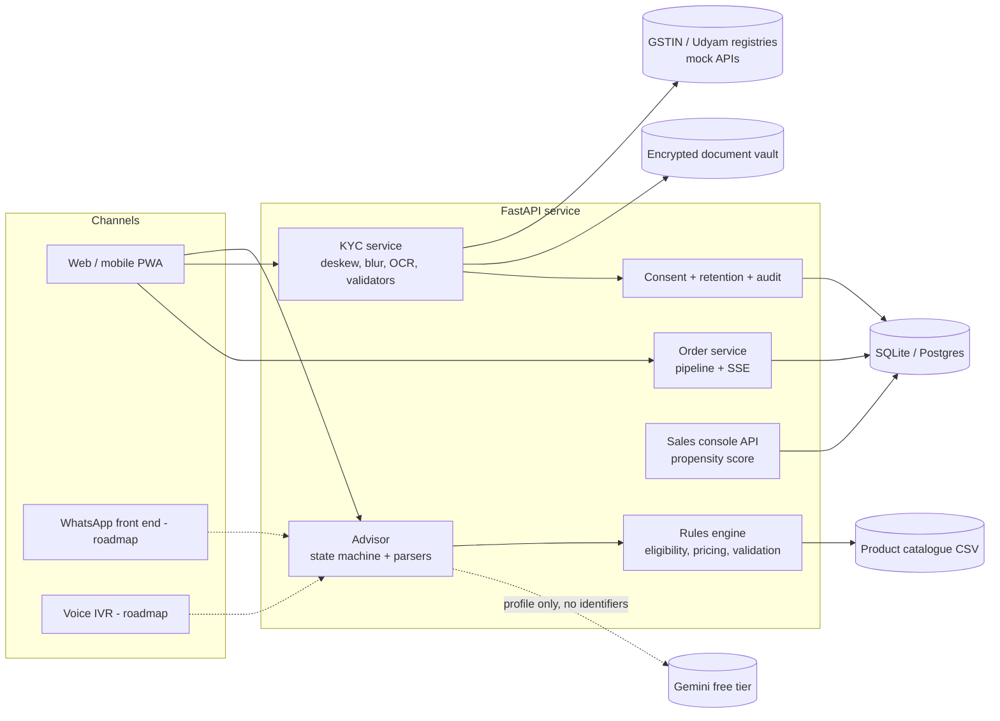

# Architecture

## Data flows

1. **Advise.** The browser sends a short answer. The state machine parses it deterministically; only if that
   fails is Gemini asked to classify it. The recommendation, price and eligibility always come from `rules.py`.
   Gemini receives the already-computed bundle (product names, quantities, price) and only phrases it.
2. **Quote.** Every toggle is sent to `/api/quote`. The server validates dependencies, city tier, size and GSTIN
   rules, then prices the bundle. The client never supplies a price; `/api/orders` recomputes it.
3. **KYC.** Consent is recorded first. Images are decoded in memory, OCR runs locally (Tesseract), identifiers are
   checked against the registries, and results are validated across documents. Files and extracted fields are
   stored encrypted (Fernet); API responses carry masked identifiers only.
4. **Orders.** A paid order moves through a persisted pipeline. Each transition is an `OrderEvent`; the tracker is
   an SSE stream that replays missed events using `Last-Event-ID`, and in-flight orders resume after a restart.
5. **Sales console.** Dropped leads from the case data are scored (profile naive Bayes with stage lift) and paired
   with a next action keyed to the drop reason.

## Design decisions worth defending

* **LLM as a narrator, not a decision maker.** A 7% funnel cannot afford a hallucinated price or an ineligible
  quote. Rules are code, covered by tests, and run again on the server at checkout.
* **Graceful degradation.** Gemini failure or rate limit opens a 60 second circuit breaker; the journey continues
  with templated English and Hindi text.
* **Registry-assisted OCR.** Tesseract misreads characters such as `0/O` and `1/I`. GSTINs are repaired with
  position-aware character fixes, then the GSTIN checksum, then the nearest registry entry, and the name check
  catches a wrong snap.
* **Retention by design.** Rejected or abandoned cases get a deletion date; a purge job removes files and fields.

## Known limits

* Registries, payments and installation are simulated (as the case requires).
* The tracker advances on a timer (`DEMO_STEP_SECONDS`) to stand in for the field back office.
* Propensity from profile features alone has a hold-out AUC of about 0.65: honest but weak; stage reached adds
  most of the signal.
* UI chrome is English; the conversation supports ten languages when a Gemini key is set, English and Hindi
  without one.
